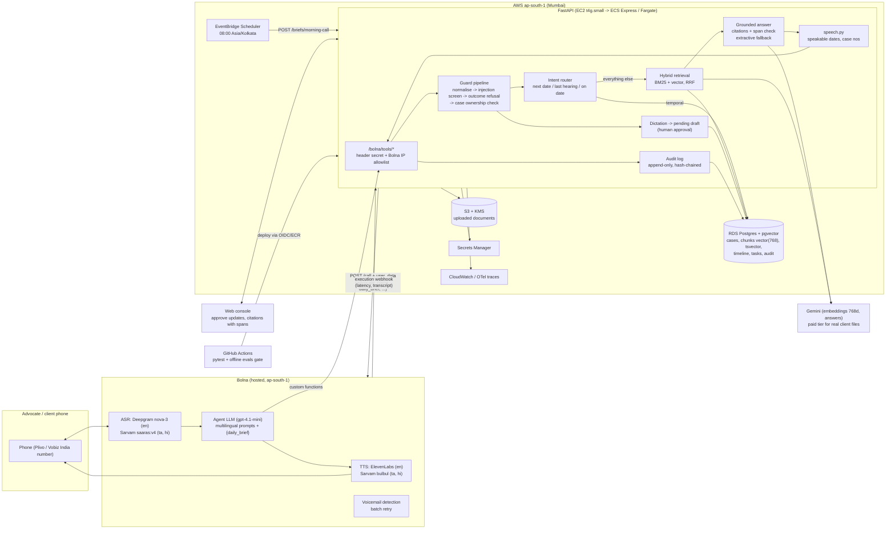

# Jolly architecture v2 (production design)

What the buildathon build grows into: the same FastAPI backend and Bolna agent, moved to India, with Postgres +
pgvector behind the existing `search()` interface, a guard pipeline on every path, evals as a CI gate, and an
append-only audit log. Research behind each choice is in the overnight notes (`rag-vectordb.md`,
`voice-agents.md`, `aws-prod.md`, `guardrails.md`, `evals.md`).

## The pieces and why

**Voice (Bolna).** Bolna stays the voice layer; facts and guardrails stay in Jolly. Tamil and Hindi run on Sarvam
through `multilingual_config`; the morning brief rides in `user_data` so the first sentence needs no tool round
trip (voice-agents.md §2.2, §4.1). Bolna calls tools from three AWS ap-south-1 addresses (13.203.39.153,
13.126.9.249, 13.202.133.53), so hosting Jolly in Mumbai shortens every tool call and keeps case data in India
(aws-prod.md §0.4). Details: `docs/VOICE_AGENT.md`.

**Compute.** Tier 1 for the buildathon: one EC2 `t4g.small` in ap-south-1 running the existing Docker image (about
$16/month), or Render as today. Tier 2: ECS Express Mode on Fargate ARM behind an ALB. App Runner is closed to
new customers; Lambda would need a NAT gateway (~$41/month) to reach both RDS and the internet, and cold starts
hit the startup index build (aws-prod.md §0).

**Retrieval.** One case at a time, tens to hundreds of chunks:
- Order sheets are chunked one dated entry per chunk, with a deterministic header (case no. · doc type · date ·
  para) and character offsets into the source document, so a citation can highlight the exact span.
- Temporal questions go to an intent router that answers from `hearing_date` and the approved timeline, not
  similarity (rag-vectordb.md §5.4).
- Everything else is hybrid: BM25 over words plus normalised legal identifiers (`pw1`, `sec138`, `cc1042_2025`,
  `d20260912`) fused with Gemini `gemini-embedding-2` vectors (768 dims, task prefixes) by Reciprocal Rank
  Fusion (rag-vectordb.md §3; Anthropic Contextual Retrieval).
- Today BM25 runs in Python and vectors are NumPy over SQLite. In production the same `search()` signature is
  backed by Postgres: `embedding vector(768)` (pgvector indexes up to 2,000 dims) plus a generated
  `tsvector` column using the `simple` config, combined in an RRF SQL function adapted from Supabase's
  hybrid-search guide. Use an exact scan per case; add HNSW with `hnsw.iterative_scan` only past ~100k chunks
  (rag-vectordb.md §2.2, §8).
- No reranker in the call path; FlashRank stays behind a flag until evals show a gain (rag-vectordb.md §4).

**Guard pipeline.** Every tool call: Unicode/spacing normalisation, then the multilingual injection screen
(documents are data, flagged chunks are never retrieved or spoken), then the outcome-question refusal, then
caller → advocate → case ownership. Fail closed when the shared secret is missing; secret in a header, not the
query string; source-IP allowlist (guardrails.md §0).

**Human approval.** Post-hearing dictation becomes a pending draft. Nothing reaches the case record or a client
until an advocate approves it with a signed single-use token (guardrails.md §1).

**Audit.** Append-only, hash-chained `audit_log` of every tool call, answer and its citations, with phone numbers
HMAC'd, kept one year to meet DPDP Rules 2025 Rule 6 duties from May 2027 (guardrails.md §0.5, aws-prod.md §7).

**Evals.** A plain Python runner over a YAML case file, run on every PR with no keys using the offline embedder and
extractive answers: citation validity, refusal correctness, injection blocking, dictation accuracy, latency.
No LLM-as-judge in CI (evals.md §0). Bolna's `latency_data.time_to_first_audio` and interruption stats from the
execution webhook go to the console.

**Privacy.** The Gemini free tier may use inputs to improve Google's products. Synthetic demo data only; real client
files go through the paid tier, or the offline embedder plus BM25 (rag-vectordb.md §7).

## Migration path

1. Now (this PR): hybrid retrieval, router, entry-level chunks with offsets, embedding fix, speakable output,
   agent v2 payload. SQLite + NumPy, all behind `search()`.
2. Next: `PgVectorRetriever` selected when `DATABASE_URL` is Postgres; documents to S3; Mumbai hosting; scheduler
   moves from GitHub Actions to EventBridge.
3. Later: span-verified LLM citations (quote must be a substring of the cited chunk), reranker if evals justify it,
   cross-case questions, eCourts sync at ingestion.
